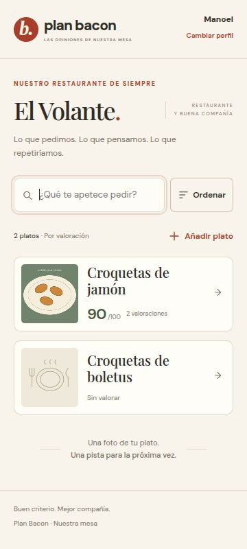

# Verificación del MVP

Entorno: local, 10 de noviembre de 2026. React/Vite y Worker en el runtime de Cloudflare; D1 y R2 emulados. Pruebas de integración aisladas con Miniflare y procesador Images local. Revisión visual en navegador Chromium integrado, viewport de 360 × 800. Esta fue la comprobación inicial local. El estado de publicación posterior aparece a continuación.

## Publicación: 11 de noviembre de 2026

- Dirección: https://plan-bacon.plan-bacon.workers.dev
- Worker: `plan-bacon`; versión Cloudflare `479f6912-d791-4033-8e17-fdf803f43308`.
- D1: `plan-bacon`, ID `4e9f758d-ab4c-4dba-ab65-554532847804`, región WEUR. Migraciones 0001 y 0002 aplicadas en remoto.
- R2: `plan-bacon-photos`, almacenamiento Standard, vinculado como `PHOTOS`.
- Binding `IMAGES` aceptado al publicar; queda pendiente probar una subida real desde móvil para verificar su operación con esta cuenta.
- Restaurante El Volante y los cuatro perfiles cargados desde la semilla. No se han trasladado los platos ni las fotos locales de prueba.
- Aviso de gasto: usuario confirma que ha guardado el aviso de 1 USD en su cuenta. No se verificó mediante API: la autorización no incluye modificar alertas de facturación.
- Autorización OAuth limitada a cuenta, usuario, Workers y D1. Se descartó el flujo inicial de Wrangler con permisos ajenos al proyecto.
- El primer acceso HTTPS recibió un fallo temporal inmediatamente después de registrar el subdominio. Resuelto tras la propagación inicial: HTML y JavaScript HTTP 200, `/api/config` devuelve Restaurante El Volante y los cuatro perfiles, `/api/platos` devuelve catálogo vacío. Comprobación ejecutada contra la dirección pública con validación TLS normal.
- CA-11 con dos móviles y fotos reales sigue pendiente.

## Cambio posterior: varias valoraciones por perfil

Esta revisión sustituye el límite de una valoración por persona del encargo inicial. La media incluye todas las opiniones. La comprobación histórica de los criterios originales sigue abajo; donde hablaba de una opinión por perfil se aplica ahora la edición de una opinión por su ID.

Pruebas nuevas aprobadas:

- Dos valoraciones del mismo Alexandre con 60 y 80, fotos distintas, total 2 y media 70.
- Editar solo la primera a 95 conservando su foto: la segunda sigue en 80, total 2, media 87,5 y miniatura de la última publicación intacta.
- Se rechaza editar una opinión desde otro perfil o desde otro plato.
- Reintentos y dos envíos simultáneos con la misma clave de solicitud producen una sola opinión; nuevas solicitudes del mismo perfil producen opiniones distintas. Incluye pérdida de respuesta después de confirmar en D1.
- Orden por puntuación descendente; en empate, publicación más reciente. Orden por fecha descendente por defecto. La miniatura y la media no dependen del orden de la ficha.
- Prueba de interfaz con dos opiniones propias: ambas ofrecen edición independiente; «Añadir valoración» abre un formulario nuevo con foto y puntuación obligatorias.
- Migración 0001 → 0002 comprobada con un registro previo: ID, foto, fechas, firma, comentario y puntuación conservados; después admite más opiniones del mismo perfil.

Revisión adicional en navegador: ficha conservada con sus dos opiniones, formulario de alta vacío aunque Alexandre ya tenga una opinión, botón de edición en la tarjeta propia y orden por puntuación confirmado (100, 80). A 360 px no hay desbordamiento horizontal (`scrollWidth == clientWidth`, 345/345 descontando la barra vertical). Captura: `screenshots/valoraciones-orden.png`.

En el entorno de este chat ya se exportó una copia a `backups/antes-varias-valoraciones-20261110.sql` y se aplicó la migración local.

Para una instalación anterior: hacer copia y ejecutar `pnpm db:migrate`. La comprobación con dos móviles y la publicación siguen pendientes.

## Evidencia ejecutada

- `pnpm setup`: migración y semilla local aplicadas.
- `pnpm demo`: dos imágenes distintas, puntuaciones 60/80, media 70, dos opiniones y recuperación de ambas fotos después del guardado.
- `pnpm check`: TypeScript sin errores.
- `pnpm test`: 15 pruebas aprobadas (11 grupos de integración, 4 de formulario/ficha). Los errores R2/D1 y el JPEG corrupto que aparecen en el registro son fallos inyectados deliberadamente.
- `pnpm build`: compilación de cliente y Worker aprobada.
- `wrangler deploy --dry-run --config dist/plan_bacon/wrangler.json`: empaquetado local aprobado, con D1, R2, Images y assets detectados. No publica ni verifica la disponibilidad de esos recursos en una cuenta.
- Navegador: selección Alexandre → Manoel, catálogo vacío, alta, búsqueda `jamon`, orden con búsqueda activa, duplicado ` CROQUETAS DE JAMON `, sugerencia `Croquetas`, alta de boletus, campos obligatorios y edición de Alexandre conservando la misma URL de foto. La edición de 60 a 100 cambió la media de 70 a 90 y mantuvo dos opiniones; Manoel siguió primero. Se abrió después la edición de Manoel con su puntuación 80 y comentario vacío.
- Navegador: sustitución de la foto de Manoel mediante selector de archivo; clave nueva, foto recuperada, firma conservada y recuento sin cambios.
- Ancho: catálogo y formulario/ficha sin desbordamiento horizontal. Lecturas DOM `scrollWidth == clientWidth`: 360/360 en catálogo y 345/345 con barra vertical en ficha y formulario. Ambas imágenes de la ficha cargadas (`complete` y `naturalWidth > 0`).

La revisión visual modificó exclusivamente los datos locales de muestra. La captura muestra la media 90 después de editar Alexandre a 100; `pnpm demo` permite volver al caso 60/80. Las ilustraciones están etiquetadas «Muestra local».

## Criterios de aceptación

| ID | Resultado local | Límite o pendiente |
| --- | --- | --- |
| CA-01 | Verificado en navegador; cuatro perfiles iniciales, entrada y cambio sin credenciales, perfil visible. | Repetir como comprobación básica tras publicar. |
| CA-02 | Búsqueda sin tildes y ficha verificadas por API y navegador. Fotos, autores, comentarios y fechas visibles. Sin desbordamiento a 360 px. | Pantalla y navegador de móvil real pendientes. |
| CA-03 | Verificado: igualdad normalizada, sugerencias, creación de boletus y carrera de dos altas con respuesta 201/409 y un mismo ID. | Sin dependencia de cuenta para la prueba local. |
| CA-04 | Verificado: dos perfiles, JPEG/PNG distintos, 60/80, media 70, total 2, miniatura de Manoel y comentario vacío. | Fotos reales de cámara/galería en CA-11. |
| CA-05 | Verificado por integración y navegador: misma firma/foto, media actualizada, dos registros, fechas y orden de publicación conservados; cada perfil edita su opinión. | Repetir tras publicación. |
| CA-06 | Catálogo vacío y ficha sin opiniones verificados visualmente; consulta sin resultados verificada por API. Los tres estados y sus acciones están implementados. | La búsqueda vacía queda cubierta por la API y el componente; no se registró una captura visual separada de ese estado. |
| CA-07 | Verificado: fallo primera/segunda escritura R2, D1 antes y después del commit; alta y sustitución; foto previa disponible, reintento sin duplicados. Tres pruebas de formulario confirman selección explícita y conservación de archivo, puntuación y comentario. | La UI usa respuestas simuladas en estas pruebas; los fallos reales de la cuenta se probarán si aparecen. Una respuesta perdida después de commit puede haber actualizado ya la ficha. |
| CA-08 | Verificado: foto y selección explícita obligatorias; puntuaciones fuera de rango, decimales, formatos falsificados, JPEG corrupto, más de 10 MB y comentario largo rechazados. JPEG/PNG/WebP aceptados, metadatos retirados, miniatura reducida. | HEIC/HEIF no se admite; usar JPEG, PNG o WebP. Orientación de cámara real pendiente. |
| CA-09 | Verificado por integración con medias distintas, empate, sin valorar y búsqueda activa; cambio de orden con filtro conservado revisado en navegador. | Sin dependencia de cuenta para la prueba local. |
| CA-10 | Semilla, alta de perfil y renombrado mediante el mismo SQL usado por la herramienta de mantenimiento, comprobados en D1 emulado. Se conservan opiniones y se rechaza un renombrado que duplica otro. | Procedimiento en la cuenta de producción pendiente. |
| CA-11 | La persistencia y recuperación de dos imágenes está comprobada localmente, incluido un cambio desde selector de archivo de escritorio. | **Pendiente**: dos móviles reales, cámara y galería, consulta cruzada, orientación y recarga en la URL publicada. |

## Prueba manual tras publicar

1. Registrar URL `workers.dev`, fecha, sistema y navegador de ambos móviles. Abrir el mismo restaurante.
2. Móvil A: Alexandre, crear un plato de prueba acordado, «Valorar», «Hacer foto», foto JPEG/PNG/WebP de su ración, 60, comentario breve. Guardar y recargar.
3. Móvil B: Manoel, abrir ese plato, «Valorar», «Elegir de galería», otra foto, 80, comentario en blanco. Guardar y recargar.
4. Desde ambos móviles, verificar las dos fotos, autores, puntuaciones, fechas, media 70, total 2 y la miniatura de Manoel. Ampliar las fotos y revisar orientación, color y legibilidad.
5. Alexandre edita a 90 conservando foto; media 85, total 2, Manoel sigue primero y sigue aportando miniatura. Cambiar a Manoel y comprobar el formulario de su propia opinión.
6. Alexandre añade otra valoración de 50 con otra foto. Deben quedar tres opiniones (dos de Alexandre), total 3 y media 220/3. Verificar «Por puntuación» (90, 80, 50) y «Por fecha» (la de 50 primero). Editar cualquiera de las dos de Alexandre desde su tarjeta y confirmar que la otra no cambia.
7. Sustituir una foto y comprobar la recuperación desde el otro móvil. Probar una interrupción de red; el formulario abierto debe conservar los campos y permitir reintentar. Comprobar de nuevo el total.
8. Descargar una versión servida y comprobar que no contiene GPS/EXIF/XMP. Confirmar que la lista usa `thumb.jpg` y la ficha `full.jpg`.
9. Registrar resultado. No marcar CA-11 como aprobado solo por haber podido abrir la web en un ordenador.

## Pendientes después de publicar

- Prueba CA-11 con dos móviles: cámara, galería, orientación y recuperación desde el otro dispositivo. El binding Images se ha aceptado al desplegar; todavía no se ha verificado una transformación de una foto real en producción.
- Restauración de una copia D1 + R2 en un entorno aparte y revisión periódica de cuotas compartidas.

Completados: conexión de cuenta autorizada por el usuario, R2 Standard, D1, migraciones 0001/0002, semilla, publicación `workers.dev`, lectura pública del restaurante y perfiles y catálogo vacío. El usuario confirma el aviso de 1 USD; esa configuración se realizó en su navegador.

## Preparación para GitHub: 15 de noviembre de 2026

- Repositorio local independiente en la carpeta `plan-bacon`, rama `main`.
- 42 archivos revisados para la primera versión. `.gitignore` excluye configuración activa, dependencias, salidas de compilación, credenciales, bases locales, fotos de muestra, exportaciones y copias. La búsqueda de formatos habituales de tokens y claves privadas en los archivos seleccionados no encontró coincidencias.
- `wrangler.production.example.json` contiene solo configuración e identificadores de recursos existentes; se comprobó que coincide con la configuración activa, sin tokens ni contraseñas. Las autorizaciones de Wrangler permanecen fuera del repositorio.
- Copia limpia exportada desde los archivos preparados para Git, sin configuración activa de producción ni datos locales del equipo.
- En esa copia: `pnpm install --offline --frozen-lockfile` utilizando la caché existente, `pnpm setup`, `pnpm check`, `pnpm test` (15 aprobadas) y `pnpm build`, todos correctos. Se ejercitaron las migraciones y semilla en almacenamiento local nuevo, sin consultar ni modificar producción.
- Versiones reproducibles: Node 22.22.1 en `.nvmrc` y pnpm 11.25.0 en `package.json`.
- Flujo `.github/workflows/checks.yml` preparado para comprobar tipos, pruebas y compilación en GitHub. No ha sido ejecutado en GitHub; requiere crear el repositorio y hacer la primera subida.
- Guía de primer envío, clonado, cambio de ordenador y autorización independiente de Cloudflare en `DOS_ORDENADORES.md`. Contexto para otros chats en `AGENTS.md` y `ESTADO.md`.
